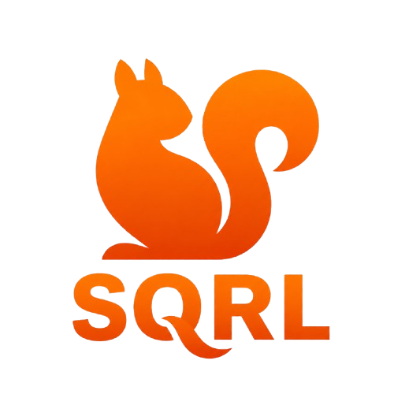
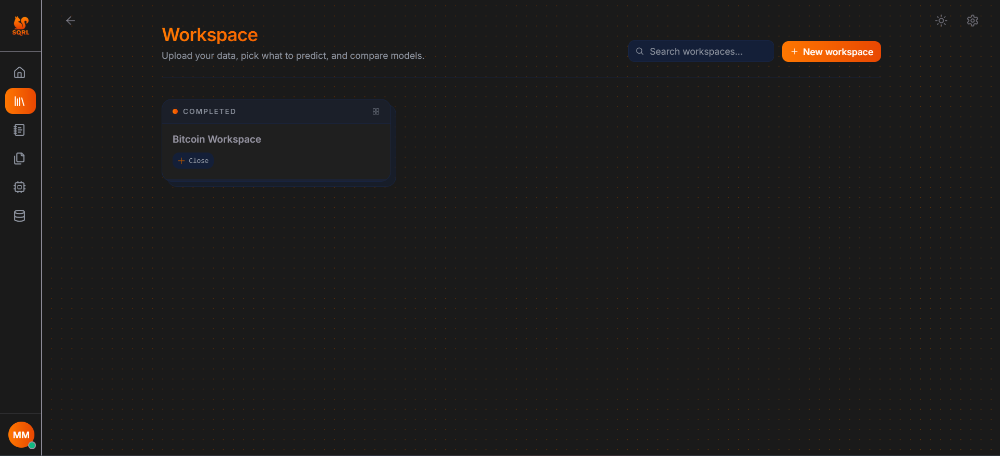
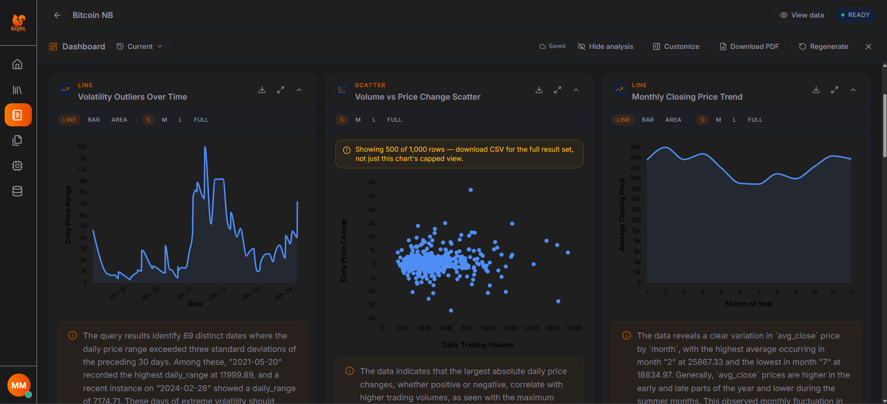
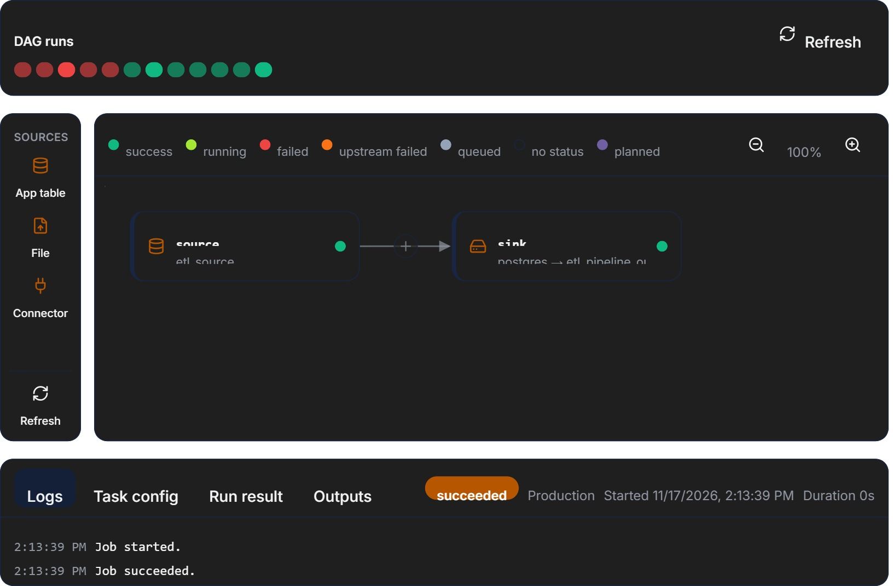
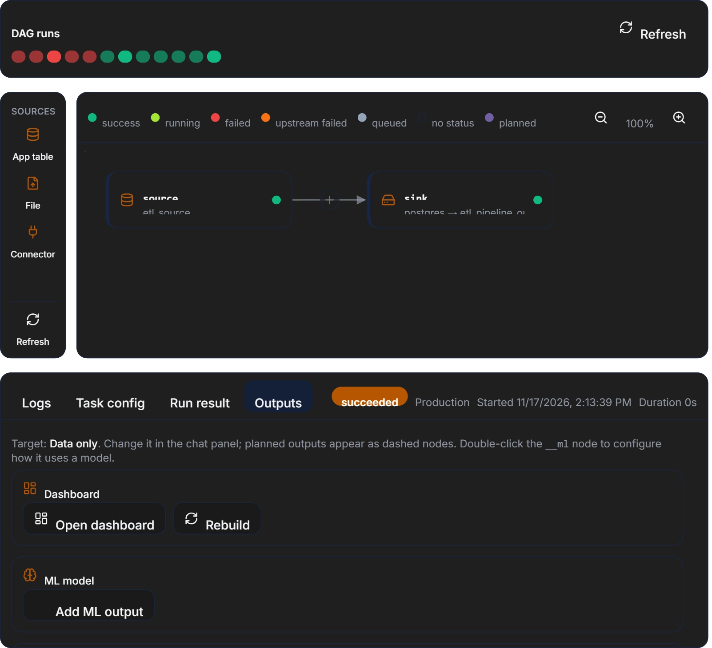
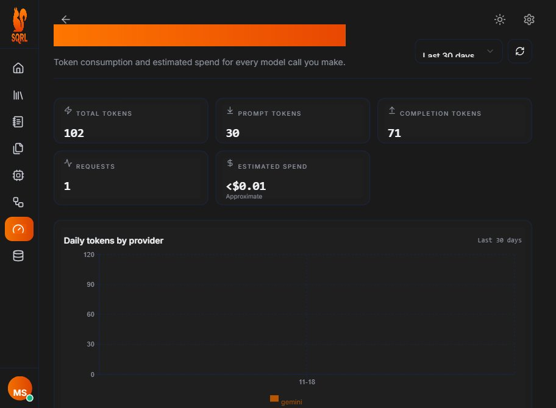
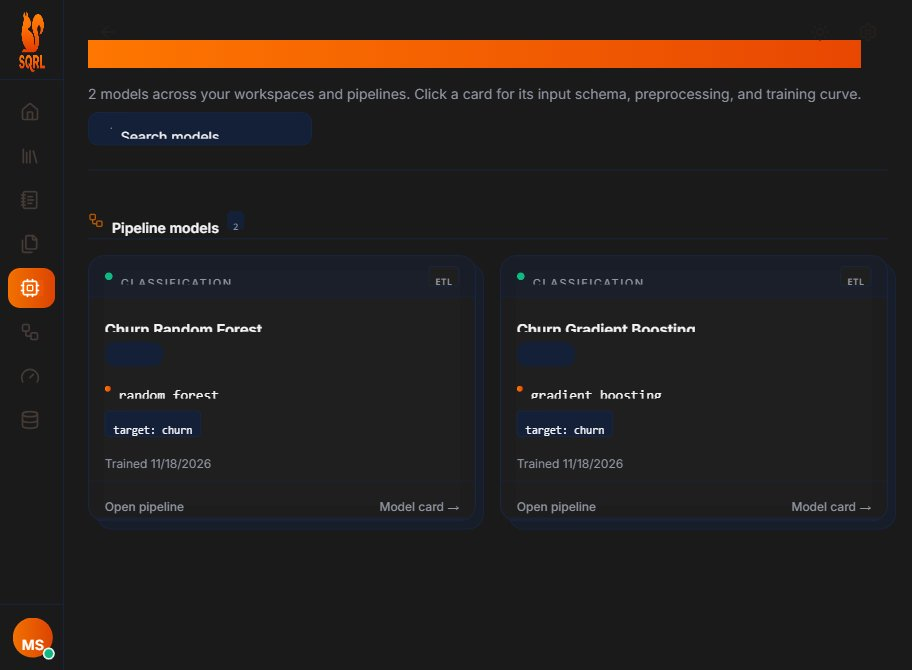
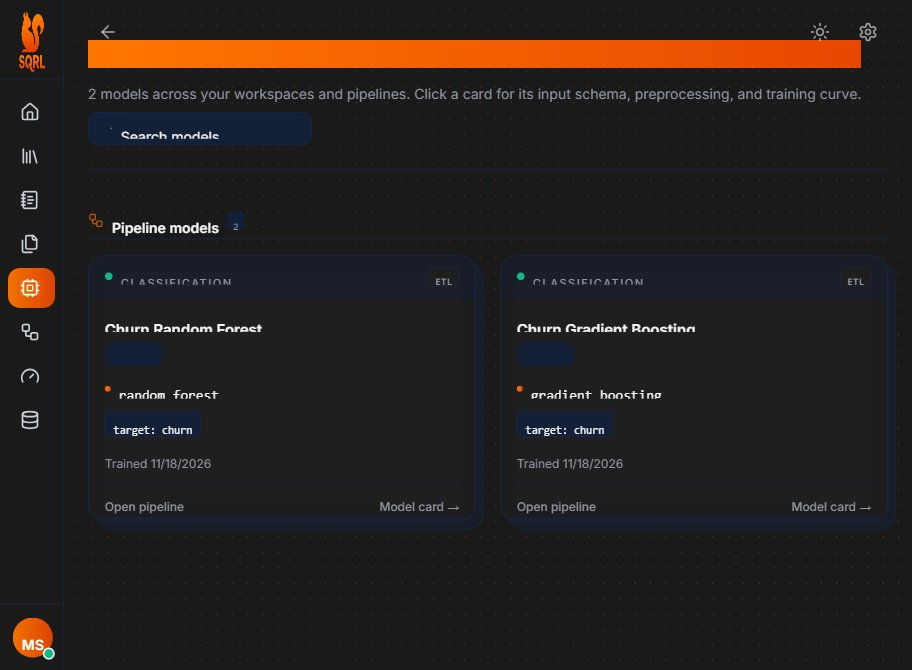
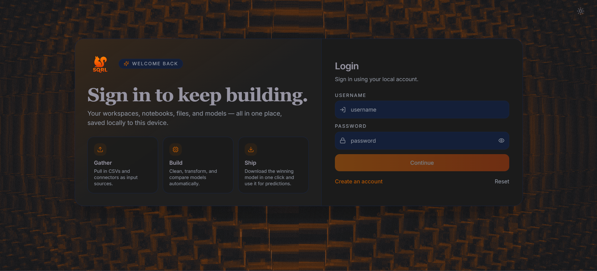

# SQRL

<div align="center">
  

  
  
  
  
</div>

Squirrel is a full-stack application for analyzing, preparing, building machine learning models, and serving predictions. It also lets you compose, schedule, and monitor multi-step ETL pipelines, build dashboards, and track LLM token usage per provider, feature, and user.

## Features

SQRL brings the complete machine-learning workflow into one workspace:

### 1. Workspace Page

Create and manage isolated workspaces for each project. Upload CSV files or
connect PostgreSQL sources, inspect datasets, choose a target column, and start
the modeling workflow from one place.



### 2. Notebook Page

Explore data through an interactive notebook experience. Review dataset
summaries, generated analysis, and recommendations while keeping the work
associated with its workspace.



### 3. Data Connection Page

Configure reusable data connections for external sources. SQRL supports
PostgreSQL connectors alongside uploaded files, allowing data to be prepared
and reused without repeatedly importing the same source.


### 4. Model Training and Comparison

Train multiple machine-learning models, compare their evaluation metrics, and
select the recommended model for a workspace. Fitted preprocessing pipelines
and model artifacts are retained for later predictions.


### 5. Predictions and External API

Submit new CSV rows to generate predictions with a completed workspace model.
The external prediction endpoint lets other applications use trained models 
through authenticated API requests.


### 6. ETL Pipelines and Visual DAG

Describe the transformation you want in natural language and the chat assistant
plans a multi-step DAG, grounded in the real schemas of your sources. Edit the
graph directly: add sources from existing app tables, uploads, or connectors,
insert transformation stages on any edge, and open a property sheet for every
source, stage, and sink. Definitions are schema-validated, dry-run before
execution, and require human approval before the first production run.



### 7. Dashboards and ML Outputs

A pipeline can publish a data table, a dashboard, a trained ML model, or both.
Dashboards are generated as notebook cells with charts and can be rearranged
and saved. Models trained by a pipeline are registered as versions and can be
refit, retrained, or used for inference from later runs.



### 8. Usage and Model Monitoring

Every LLM call is attributed to the signed-in user, the calling feature, the
provider, and the model. The Usage page shows daily token consumption, request
counts, estimated spend from public list prices, and a filterable history of
recent calls. Model cards collect the expected input schema, the preprocessing
that ran before fitting, and the training curve (epoch loss for sequential
models or a learning curve for the winning estimator) so you can inspect a
model without re-reading the run logs.







### 9. Authentication and Storage

Protect workspaces with user authentication while PostgreSQL stores application
metadata and MinIO stores uploaded files, processed datasets, pipelines, and
model artifacts.



## Recent Updates

- **Visual ETL pipelines.** A conversational planner turns a request into a
  multi-step DAG with explicit sources, transformation stages, and a sink. The
  editor validates the definition, blocks execution until it is approved, and
  supports adding sources from app tables, uploads, and connectors.
- **Pipeline dashboards.** `GET/POST /api/pipelines/{id}/dashboard` auto-provisions
  a notebook and dashboard cell per pipeline; layouts are saved and the modal
  opens automatically when a run succeeds.
- **ML outputs and model versions.** Pipelines can train, retrain, or run
  inference with a registered model (`etl_models`). Retraining records a new
  version instead of mutating the original, and every model carries a card with
  its input schema, preprocessing, and training curve.
- **Scheduling.** Pipelines support manual, interval, and cron-style schedules
  dispatched by a 30-second Celery beat job. Scheduled runs still respect the
  approval gate.
- **LLM usage monitoring.** Token usage and estimated cost are recorded per
  provider, feature, model, and user, with a dedicated Usage page and API.
- **Test and coverage expansion.** The backend suite grew to 1,152 tests across
  33 test modules, with coverage measurement wired into `pytest`.

## Architecture

```text
Browser
	|
	| http://localhost:8000
	v
sqrl container
	|- FastAPI API: /api/*
	|- Compiled React SPA: /*
	|
	+--> PostgreSQL: application records, workspaces, pipelines, usage events
	+--> MinIO: files, processed CSVs, pipelines, and models
	+--> Redis: Celery broker and result backend
	         |
	         +--> worker: pipeline runs, notifications, exports
	         +--> beat: due-pipeline dispatcher (every 30s)
```

The root `Dockerfile` uses a multi-stage build:

1. Node builds `frontend/dist`.
2. Python installs backend dependencies.
3. FastAPI serves the compiled frontend and API from the same container.

## Requirements

For Docker deployment:

- Docker Desktop with Compose support

For local development:

- Python 3.10 or newer
- Node.js 20 or newer
- npm
- PostgreSQL and MinIO, unless using the Compose services

## Docker Quick Start

Create a local environment file if one does not exist:

```powershell
Copy-Item .env.example .env
```

Add the required provider credentials to `.env`. Do not commit `.env` or real API keys.

Start the stack from the repository root:

```powershell
docker compose up --build -d
```

Open the application at:

```text
http://localhost:8000
```

Useful service URLs:

| Service | URL |
| --- | --- |
| Squirrel | http://localhost:8000 |
| API docs | http://localhost:8000/docs |
| PostgreSQL | http://localhost:5433 |
| MinIO API | http://localhost:9000 |
| MinIO console | http://localhost:9001 |
| pgAdmin | http://localhost:5050 |

View application logs:

```powershell
docker compose logs -f sqrl
```

Stop the stack:

```powershell
docker compose down
```

Stop the stack and delete database/object-storage volumes:

```powershell
docker compose down -v
```

The last command permanently removes local PostgreSQL and MinIO data.

## Environment Configuration

The backend reads settings from `.env` through Docker Compose. Start with `.env.example` and configure at least the provider keys required by the agents you plan to use.

Common variables:

| Variable | Purpose |
| --- | --- |
| `ENVIRONMENT` | Runtime environment, such as `development` or `production` |
| `LOG_LEVEL` | Backend logging level |
| `DATABASE_URL` | Optional database connection override |
| `MINIO_ENDPOINT` | MinIO endpoint used by the backend |
| `MINIO_BUCKET` | Object-storage bucket name |
| `MINIO_ACCESS_KEY` | MinIO access key |
| `MINIO_SECRET_KEY` | MinIO secret key |
| `GEMINI_API_KEY_V1` | Gemini provider credential |
| `GROQ_API_KEY_V1` | Groq provider credential |
| `OPENROUTER_API_KEY_V1` | OpenRouter provider credential |

For the single-container deployment, the frontend uses the relative API base `/api`. This allows the browser to call the backend through the same origin and avoids hard-coded container or host addresses.

## Application Workflow

1. Register or log in at `/signup` or `/login`.
2. Create a workspace at `/workspace`.
3. Upload CSV files or attach a configured PostgreSQL connector.
4. Choose the target column and optionally describe how sources should relate.
5. Build models.
6. Review preprocessing steps, transformed data, model metrics, and recommendations.
7. Use the prediction form to score new CSV rows.
8. Use the external API panel to call the trained model from another application.
9. Open `/pipelines` to create an ETL pipeline, describe the transformation in
   the chat, and approve it before the first production run.
10. Add a dashboard or ML output to the pipeline, then open the generated
    dashboard from the Outputs tab.
11. Schedule the pipeline for interval or cron-style runs, or trigger it
    manually from the editor.
12. Open `/usage` to review token consumption and estimated spend per provider,
    feature, model, and user.

## Prediction API

All protected API requests require a bearer token obtained from `/api/auth/login` or `/api/auth/register`.

Register:

```http
POST http://localhost:8000/api/auth/register
Content-Type: application/json
```

```json
{
	"username": "analyst",
	"email": "analyst@example.com",
	"password": "replace-with-a-strong-password",
	"full_name": "Data Analyst"
}
```

Predict with a completed workspace:

```http
POST http://localhost:8000/api/workspace/{workspace_id}/api/predict
Authorization: Bearer <access_token>
Content-Type: application/json
```

```json
{
	"rows": [
		{
			"age": 42,
			"income": 72000,
			"region": "north"
		}
	],
	"model_key": "random_forest"
}
```

Omit `model_key` to use the workspace's recommended model. The rows must contain the raw feature names expected by the workspace. The backend replays the fitted preprocessing pipeline before running the model.

The original authenticated route is also available:

```text
POST /api/workspace/{workspace_id}/predict
```

## Local Development

### Backend

```powershell
Push-Location backend
python -m venv .venv
\.venv\Scripts\Activate.ps1
pip install -r requirements.txt
uvicorn main:app --reload --host 0.0.0.0 --port 8000
Pop-Location
```

### Frontend

```powershell
Push-Location frontend
npm install
npm run dev
Pop-Location
```

The frontend development server runs at `http://localhost:5173`. Set `VITE_BACKEND_API_BASE_URL` in a local frontend environment file when the backend is not available at the default relative `/api` path:

```text
VITE_BACKEND_API_BASE_URL=http://localhost:8000/api
```

Useful frontend commands:

```powershell
npm run build
npm run lint
```

## Testing and Coverage

The backend test suite uses `pytest` with `pytest-cov`:

```powershell
Push-Location backend
\.venv\Scripts\python.exe -m pip install -r requirements-dev.txt
\.venv\Scripts\python.exe -m pytest -q --cov=squirrel --cov-report=term-missing
Pop-Location
```

Latest run on the `dev` branch:

| Check | Result |
| --- | --- |
| Backend tests | **1,152 passed** in ~20s (33 test modules) |
| Backend coverage | **70%** (12,892 statements, 3,845 missed) |
| Frontend type-check | `npx tsc -b --pretty false` — clean |
| Frontend production build | `npm run build` — succeeded (1,986.96 kB main chunk, gzip 561.57 kB) |

Coverage highlights:

| Area | Coverage |
| --- | --- |
| Schemas | 96–100% |
| Constants and middleware | 100% |
| Storage (MinIO, Postgres) | 96–100% |
| Usage monitoring (`services/usage`, `routes/usage`) | 95–100% |
| Pipeline compiler | 93% |
| Workspace service | 93% |
| Notebook service | 94% |
| Core config and logging | 93–94% |
| API routes (varies by router) | 35–95% |
| Pipeline tasks | 69% |

The remaining gaps are the LLM-driven agents (`exploratory`, `builder`,
`preprocessor`, `inspector`) and provider adapters, which are exercised through
their deterministic helpers and import-smoke tests rather than live model calls.
A few less-used API routes (workspace exports, notebook exports) and the
notification task are also below 50%. `tests/test_module_imports.py` imports
every module so syntax and import-time failures are caught for the whole
package.

The suite covers:

- Core configuration, middleware, request context, logging, and Celery wiring.
- Constants, Pydantic schemas, prompt rendering, inspectors, preprocessors, and
  model wrappers.
- Auth, messaging, file, storage, connector, postgres, notebook, workspace, and
  usage services against in-memory fakes.
- API routes through `fastapi.testclient.TestClient` with dependency overrides.
- ETL planning, compilation, outputs, pipeline jobs, and scheduling helpers.
- Model-card details: input schema, preprocessing steps, learning curves, and
  Keras epoch history.

> Coverage is reported honestly: it measures executed lines, not whether the
> assertions are meaningful. The low-coverage LLM agent paths need a mocked
> provider to test deterministically and are intentionally not counted as
> "covered" by the import smoke test.

## Build Status

| Component | Status |
| --- | --- |
| Backend (`pytest`) | Passing |
| Backend coverage gate | 70% (informational) |
| Frontend (`tsc`) | Passing |
| Frontend (`vite build`) | Passing |
| Docker Compose | Multi-stage image builds the SPA and serves it from FastAPI |

Known non-blocking issues: the repository ESLint config is currently broken,
Vite warns about a chunk larger than 500 kB, and the pipeline editor's
two-column layout collapses below 1024px.

## Project Layout

```text
.
|- Dockerfile                 # Combined frontend/backend production image
|- docker-compose.yml         # Application, worker, beat, PostgreSQL, MinIO, Redis, pgAdmin
|- backend/
|  |- main.py                 # FastAPI application entry point
|  |- squirrel/api/           # API routers
|  |- squirrel/services/      # Workspace, pipeline, notebook, storage, auth, usage services
|  |- squirrel/modules/       # Inspectors, preprocessors, agents, and providers
|  |- squirrel/schemas/       # API and domain schemas
|  |- tests/                  # pytest suites and in-memory fakes
|  `- requirements.txt
|- frontend/
|  |- src/                    # React application
|  |- public/imgs/            # Public image assets served at /imgs/*
|  `- package.json
|- imgs/                      # README screenshots
`- .env.example
```

## License
This project is licensed under the GNU General Public License v2.0 - see the [LICENSE](LICENSE) file for details.
