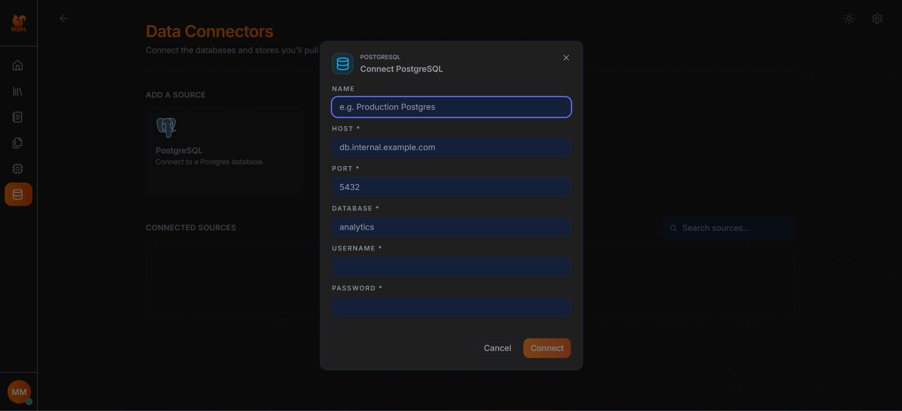
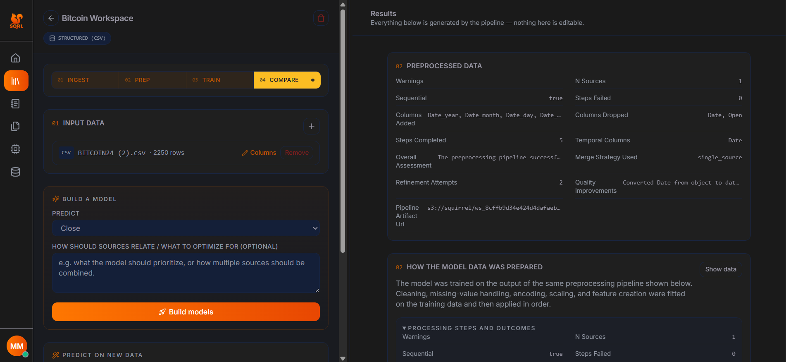
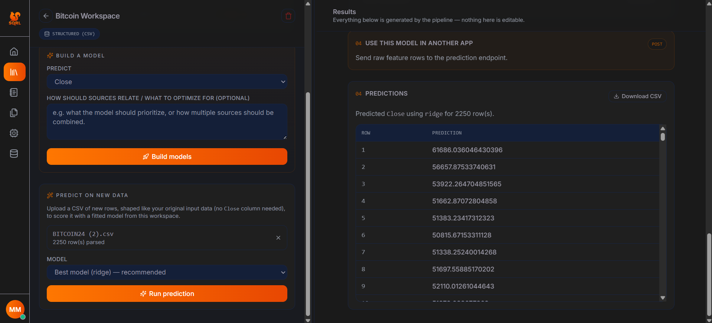
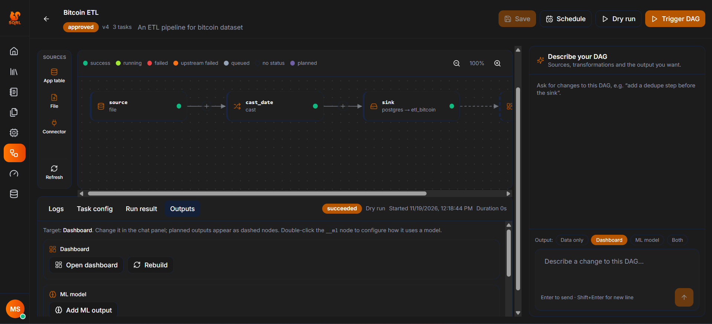

<div align="center">
  

  **An end-to-end workspace for data analysis, machine learning, ETL pipelines, and LLM usage monitoring.**

  [](LICENSE)
  [](https://www.python.org/downloads/)
  [](https://github.com/pytest-dev/pytest)
  [](https://github.com/MazenS0liman/SQRL/actions/workflows/ci.yml)
  [](https://codecov.io/gh/MazenS0liman/SQRL)
  [](https://hub.docker.com/r/mazensoliman/sqrl)
  [](https://hub.docker.com/r/mazensoliman/sqrl)

</div>

---

## Table of Contents

- [Overview](#overview)
- [What's New](#whats-new)
- [Features](#features)
- [Architecture](#architecture)
- [Getting Started](#getting-started)
- [Configuration](#configuration)
- [Usage](#usage)
- [Prediction API](#prediction-api)
- [Local Development](#local-development)
- [Project Structure](#project-structure)
- [License](#license)

## Overview

SQRL is a full-stack application that brings the complete machine-learning workflow into a single workspace. It enables you to:

- Analyze and prepare datasets from uploaded files or external databases
- Train, compare, and serve machine-learning models
- Compose, schedule, and monitor multi-step ETL pipelines
- Build dashboards from pipeline outputs
- Track LLM token usage and estimated cost per provider, feature, and user

## What's New

| Area | Highlights |
| --- | --- |
| **Visual ETL pipelines** | A conversational planner converts a natural-language request into a multi-step DAG with explicit sources, transformation stages, and a sink. The editor validates definitions, blocks execution until they are approved, and supports adding sources from app tables, uploads, and connectors. |
| **Pipeline dashboards** | `GET/POST /api/pipelines/{id}/dashboard` auto-provisions a notebook and dashboard cell for each pipeline. Layouts are saved, and the dashboard modal opens automatically after a successful run. |
| **ML outputs and model versions** | Pipelines can train, retrain, or run inference with a registered model (`etl_models`). Retraining records a new version rather than mutating the original, and each model carries a card describing its input schema, preprocessing, and training curve. |
| **Scheduling** | Pipelines support manual, interval, and cron-style schedules, dispatched by a 30-second Celery beat job. Scheduled runs still respect the approval gate. |
| **LLM usage monitoring** | Token usage and estimated cost are recorded per provider, feature, model, and user, and exposed through a dedicated Usage page and API. |
| **Testing** | The backend suite now contains 1,152 tests across 33 modules, with coverage measurement integrated into `pytest`. |

## Features

### 1. Workspaces

Create isolated workspaces for each project. Upload CSV files or connect PostgreSQL sources, inspect datasets, choose a target column, and start the modeling workflow from a single place.


### 2. Notebooks

Explore data in an interactive notebook. Review dataset summaries, generated analysis, and recommendations, with all work kept associated with its workspace.


### 3. Data Connections

Configure reusable connections to external sources. SQRL supports PostgreSQL connectors alongside uploaded files, so data can be prepared and reused without repeatedly importing the same source.



### 4. Model Training and Comparison

Train multiple machine-learning models, compare their evaluation metrics, and select the recommended model for a workspace. Fitted preprocessing pipelines and model artifacts are retained for later predictions.



### 5. Predictions and External API

Submit new CSV rows to generate predictions with a completed workspace model. The external prediction endpoint allows other applications to use trained models through authenticated API requests.



### 6. ETL Pipelines and Visual DAG

Describe the transformation you want in natural language, and the chat assistant plans a multi-step DAG grounded in the real schemas of your sources. You can then:

- Edit the graph directly
- Add sources from existing app tables, uploads, or connectors
- Insert transformation stages on any edge
- Open a property sheet for every source, stage, and sink



## Architecture

```text
Browser
    |
    | http://localhost:8000
    v
sqrl container
    |- FastAPI API: /api/*
    |- Compiled React SPA: /*
    |
    +--> PostgreSQL: application records, workspaces, pipelines, usage events
    +--> MinIO: files, processed CSVs, pipelines, and models
    +--> Redis: Celery broker and result backend
             |
             +--> worker: pipeline runs, notifications, exports
             +--> beat: due-pipeline dispatcher (every 30s)
```

The root `Dockerfile` uses a multi-stage build:

1. Node builds `frontend/dist`.
2. Python installs backend dependencies.
3. FastAPI serves the compiled frontend and the API from the same container.

## Getting Started

### Prerequisites

**Docker deployment**

- Docker Desktop with Compose support

**Local development**

- Python 3.10 or newer
- Node.js 20 or newer, and npm
- PostgreSQL and MinIO (unless using the Compose services)

### Quick Start with Docker

1. Create a local environment file:

   ```powershell
   Copy-Item .env.example .env
   ```

2. Add the required provider credentials to `.env`.

3. Start the stack from the repository root:

   ```powershell
   docker compose up --build -d
   ```

4. Open the application at <http://localhost:8000>.

### Service URLs

| Service | URL |
| --- | --- |
| SQRL | http://localhost:8000 |
| API docs | http://localhost:8000/docs |
| PostgreSQL | http://localhost:5433 |
| MinIO API | http://localhost:9000 |
| MinIO console | http://localhost:9001 |
| pgAdmin | http://localhost:5050 |

### Common Commands

```powershell
# View application logs
docker compose logs -f sqrl

# Stop the stack
docker compose down

# Stop the stack and delete database and object-storage volumes
docker compose down -v
```

> **Warning:** `docker compose down -v` permanently removes local PostgreSQL and MinIO data.

### Using the Published Image

Every push to `main` and every `v*.*.*` tag publishes the combined image to [Docker Hub](https://hub.docker.com/r/mazensoliman/sqrl):

```powershell
docker pull mazensoliman/sqrl:latest
```

To run the published image instead of building from source, replace the `build:` block in the shared `x-app` anchor of `docker-compose.yml` with a pinned tag:

```yaml
x-app: &app
  image: mazensoliman/sqrl:latest
```

Also remove the `./backend/squirrel:/app/squirrel` bind mount when using the published image; otherwise your local source will shadow the code inside the container.

## Configuration

The backend reads its settings from `.env` through Docker Compose. Start from `.env.example` and configure at least the provider keys required by the agents you plan to use.

| Variable | Purpose |
| --- | --- |
| `ENVIRONMENT` | Runtime environment, such as `development` or `production` |
| `LOG_LEVEL` | Backend logging level |
| `DATABASE_URL` | Optional database connection override |
| `MINIO_ENDPOINT` | MinIO endpoint used by the backend |
| `MINIO_BUCKET` | Object-storage bucket name |
| `MINIO_ACCESS_KEY` | MinIO access key |
| `MINIO_SECRET_KEY` | MinIO secret key |
| `GEMINI_API_KEY_V1` | Gemini provider credential |
| `GROQ_API_KEY_V1` | Groq provider credential |
| `OPENROUTER_API_KEY_V1` | OpenRouter provider credential |

In the single-container deployment, the frontend uses the relative API base `/api`. This lets the browser call the backend through the same origin and avoids hard-coded container or host addresses.

## Usage

1. Register or log in at `/signup` or `/login`.
2. Create a workspace at `/workspace`.
3. Upload CSV files or attach a configured PostgreSQL connector.
4. Choose the target column and, optionally, describe how sources relate to each other.
5. Build models.
6. Review preprocessing steps, transformed data, model metrics, and recommendations.
7. Use the prediction form to score new CSV rows.
8. Use the external API panel to call the trained model from another application.
9. Open `/pipelines` to create an ETL pipeline, describe the transformation in the chat, and approve it before the first production run.
10. Add a dashboard or ML output to the pipeline, then open the generated dashboard from the **Outputs** tab.
11. Schedule the pipeline for interval or cron-style runs, or trigger it manually from the editor.
12. Open `/usage` to review token consumption and estimated spend per provider, feature, model, and user.

## Prediction API

All protected API requests require a bearer token obtained from `/api/auth/login` or `/api/auth/register`.

### Register

```http
POST http://localhost:8000/api/auth/register
Content-Type: application/json
```

```json
{
  "username": "analyst",
  "email": "analyst@example.com",
  "password": "replace-with-a-strong-password",
  "full_name": "Data Analyst"
}
```

### Predict

```http
POST http://localhost:8000/api/workspace/{workspace_id}/api/predict
Authorization: Bearer <access_token>
Content-Type: application/json
```

```json
{
  "rows": [
    {
      "age": 42,
      "income": 72000,
      "region": "north"
    }
  ],
  "model_key": "random_forest"
}
```

- Omit `model_key` to use the workspace's recommended model.
- Rows must contain the raw feature names expected by the workspace. The backend replays the fitted preprocessing pipeline before running the model.
- The original authenticated route remains available at `POST /api/workspace/{workspace_id}/predict`.

## Local Development

### Backend

```powershell
Push-Location backend
python -m venv .venv
.\.venv\Scripts\Activate.ps1
pip install -r requirements.txt
uvicorn main:app --reload --host 0.0.0.0 --port 8000
Pop-Location
```

### Frontend

```powershell
Push-Location frontend
npm install
npm run dev
Pop-Location
```

The development server runs at <http://localhost:5173>. If the backend is not available at the default relative `/api` path, set the following in a local frontend environment file:

```text
VITE_BACKEND_API_BASE_URL=http://localhost:8000/api
```

Other useful frontend commands:

```powershell
npm run build
npm run lint
```

## Project Structure

```text
.
|- Dockerfile                 # Combined frontend/backend production image
|- docker-compose.yml         # App, worker, beat, PostgreSQL, MinIO, Redis, pgAdmin
|- backend/
|  |- main.py                 # FastAPI application entry point
|  |- squirrel/api/           # API routers
|  |- squirrel/services/      # Workspace, pipeline, notebook, storage, auth, usage services
|  |- squirrel/modules/       # Inspectors, preprocessors, agents, and providers
|  |- squirrel/schemas/       # API and domain schemas
|  |- tests/                  # pytest suites and in-memory fakes
|  `- requirements.txt
|- frontend/
|  |- src/                    # React application
|  |- public/imgs/            # Public image assets served at /imgs/*
|  `- package.json
|- imgs/                      # README screenshots
`- .env.example
```

## License

This project is licensed under the GNU General Public License v2.0. See the [LICENSE](LICENSE) file for details.